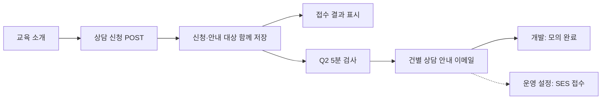

# 어썸스쿨 교육 신청 시스템

교육 소개를 확인한 방문자가 상담을 신청하고, 연락 가능 날짜에 안내를 받는 Django 사전 과제입니다.
신청은 수강 확정이 아닌 **상담 접수**로 해석했습니다. 연락 가능 날짜도 교육 희망일과 구분합니다.

[실행 방법](#로컬-실행) · [기능 확인](#실행-후-확인) · [백오피스](#담당자용-백오피스) · [신청 샘플](#선택-백오피스-신청-샘플-32건) · [설계 의도](#주요-설계-의도) · [과제 원문](docs/awesomeschool-assignment.md)

## 구현 범위

| 과제 항목 | 현재 구현 |
| --- | --- |
| 교육 소개·관리 | 랜딩·교육 3개의 상세·커리큘럼·대표 이미지·접수 가능 여부. 기본 admin 등록·편집 |
| 교육 신청 | 반응형 폼·주소 검색/직접 입력·Axios 비동기 제출·접수 상태 표시 |
| 신청 관리 | 반응형 백오피스와 기본 admin에서 조회·정정·상담·재연락·상태 관리. 변경 이력은 admin 조회. 신청 삭제 금지 |
| DRF API | 신청 화면용 교육정보 GET·신청 POST·검증·반복 제출 보호 |
| 자동 안내 | Q2 날짜별 검사·개발 모의 처리·운영 SES backend·선별 재시도 |
| 개발 프리셋 | 교육 3개·이미지 기본 준비, 기존 staff를 지정해 신청 32건·상담·모의 이메일 상태 선택 생성 |

별도 백오피스는 신청·상담 관리와 이메일 처리 상태 조회에 집중하고 교육·계정·권한·이력 상세와 내부 task 기록은 Django admin에서 확인합니다. Google Spreadsheet 내보내기는 미구현입니다. 과제의 삭제 항목 대신 신청·상담 기록을 보존하고 완료·취소로 처리하는 정책을 선택했습니다. AWS는 SES·S3/CloudFront 설정을 구현했으며 실제 배포와 운영 static 서빙은 포함하지 않았습니다.

## 로컬 실행

**macOS/Linux의 Bash 기준**입니다. 저장소를 내려받은 뒤 루트 디렉터리에서 실행합니다.
준비 도구는 **[uv](https://docs.astral.sh/uv/getting-started/installation/)와 [Docker Compose v2](https://docs.docker.com/compose/install/)**입니다. Docker 엔진을 먼저 실행해 주세요. Python은 uv가 `.python-version`에 맞춰 준비합니다.
빌드된 CSS·JavaScript가 저장소에 포함되어 **Node.js·프론트 빌드·AWS 자격 증명 없이 실행**할 수 있습니다.

### 1. 의존성 설치

lockfile에 기록한 Python 패키지를 설치합니다. 별도의 가상환경 활성화는 필요하지 않습니다.

```bash
uv sync --locked
```

### 2. 개발 환경 변수 준비

아래 명령은 `.env.example`을 바탕으로 `.env`를 만들고 Django secret key·DB 비밀번호를 생성합니다. **이미 `.env`가 있으면 보존**하며 비밀값은 출력하지 않습니다.

```bash
uv run python - <<'PY'
from pathlib import Path
import secrets

path = Path(".env")
if not path.exists():
    content = Path(".env.example").read_text(encoding="utf-8")
    for key in ("DJANGO_SECRET_KEY", "POSTGRES_PASSWORD"):
        content = content.replace(f"{key}=\n", f"{key}={secrets.token_urlsafe(32)}\n")
    path.write_text(content, encoding="utf-8")
print(".env 준비 완료: 기존 파일은 보존합니다.")
PY
```

Django와 Compose가 이 파일을 읽습니다. 로컬은 기본 `config.settings.dev`·`DJANGO_DEBUG=true`를 사용하며 AWS 항목은 비워 둡니다. 기존 DB volume이 있다면 기존 비밀번호를 유지합니다.

### 3. PostgreSQL 실행

DB만 컨테이너로 실행하고 연결 가능한 상태가 될 때까지 기다립니다. Django는 호스트에서 실행합니다.

```bash
docker compose up -d --wait db
```

기본 DB 포트는 `127.0.0.1:15432`입니다. 포트가 겹치면 `.env`의 `POSTGRES_PORT`를 변경합니다.

### 4. 테이블·샘플 교육 준비

`migrate`는 테이블을 만들고, `seed_educations`는 교육 3개와 로컬 이미지를 준비합니다. 초기 데이터 명령은 반복해도 기존 교육을 덮어쓰지 않습니다. 프로젝트의 migration은 빈 DB에 적용하는 `src/education/migrations/0001_initial.py` 하나입니다. 이전 개발 이력을 적용한 DB의 처리와 관리자 계정 준비는 [초기 migration 안내](docs/guides/operations.md#초기-migration과-개발-db-재생성)를 확인하세요.

```bash
uv run python src/manage.py migrate --noinput
uv run python src/manage.py seed_educations
uv run python src/manage.py check
```

백오피스용 신청 샘플도 확인하려면 worker를 시작하기 전에 [선택 샘플 준비](#선택-백오피스-신청-샘플-32건)를 진행합니다. 기본 명령은 신청이나 계정을 생성하지 않습니다.

### 5. 자동 안내 스케줄 등록

연락 가능 날짜가 된 신청을 **5분마다 검사하는 스케줄을 DB에 등록**합니다. 반복해도 중복 등록되지 않습니다. 이 명령이 worker를 실행하거나 메일을 보내지는 않습니다.

```bash
uv run python src/manage.py configure_background_tasks
```

### 6. 웹 서버·worker 실행

**터미널 1 — 웹 페이지와 API:**

```bash
uv run python src/manage.py runserver 127.0.0.1:8000
```

**터미널 2 — 같은 저장소 루트에서 자동 안내·이미지 정리 실행:**

```bash
uv run python src/manage.py qcluster
```

`qcluster`에 scheduler와 worker가 함께 포함됩니다. Redis나 별도 Beat 프로세스는 필요하지 않습니다. 웹 서버만 실행해도 신청은 저장되지만 안내와 이미지 정리는 worker가 있어야 처리됩니다.

## 실행 후 확인

1. [랜딩](http://127.0.0.1:8000/)에서 교육 3개를 확인하고 상세 페이지로 이동합니다.
2. **상담 신청**에서 이름·이메일·주소·오늘 이후 연락 가능 날짜를 입력합니다. 주소 검색을 사용할 수 없으면 직접 입력할 수 있습니다.
3. 제출 후 새로고침 없이 **신청 상태: 접수**와 접수 식별자가 표시되는지 확인합니다.
4. 자동 안내 처리 현황은 아래 명령으로 확인합니다. 개발은 실제 이메일을 보내지 않고 처리 완료를 `simulated`로 기록합니다.

```bash
uv run python src/manage.py notification_status
```

안내 대상은 **연락 가능 날짜의 한국 시각 09시부터**이며 다음 5분 검사와 큐 대기 후 처리됩니다. 오늘을 선택해도 09시 전이면 대기합니다. 즉시 확인용 자동 테스트와 API·장애 재현 방법은 [기능 검증 가이드](docs/guides/verification.md)에 있습니다.

관리 기능은 아래 [담당자용 백오피스](#담당자용-백오피스)에서 확인합니다. 교육 편집·권한 설정·변경 이력 조회는 Django admin을 사용합니다.

종료할 때는 웹 서버·qcluster에서 `Ctrl+C`를 누르고 worker의 처리·결과 저장이 끝날 때까지 기다린 뒤 `docker compose down`으로 DB를 중지합니다. DB volume은 삭제하지 않습니다.

### 담당자용 백오피스

먼저 관리자 계정을 만듭니다.

```bash
uv run python src/manage.py createsuperuser
```

같은 계정으로 [백오피스](http://127.0.0.1:8000/backoffice/)와 [Django admin](http://127.0.0.1:8000/admin/)에 로그인할 수 있습니다. 두 화면은 로그인·로그아웃 상태를 공유합니다.

- **백오피스:** 신청 검색·필터·페이지네이션, 신청 정보·상태·재연락 일정 변경, 상담 기록 조회·추가
- **이메일 상태:** 상세의 **상태 새로고침**으로 작성 중인 입력을 유지하며 처리 상태 조회
- **Django admin:** 교육 편집, 계정·권한 설정, 변경 이력·내부 task 기록 조회

superuser로 전체 기능을 확인할 수 있습니다. [백오피스 확인 절차](docs/guides/verification.md#백오피스-확인)와 [담당자별 권한·오류 대응](docs/guides/operations.md#백오피스-계정과-요청-처리)은 가이드를 참고하세요.

### 선택: 백오피스 신청 샘플 32건

페이지네이션·검색·상태·재연락·상담·이메일 표시를 확인하려면 **기존 활성 staff 계정을 먼저 준비하고 qcluster를 중지한 개발 DB**에서 실행합니다. `reviewer`는 본인이 준비한 기존 사용자명으로 바꿉니다.

```bash
uv run python src/manage.py seed_educations --with-applications --staff-user reviewer
```

교육 3개에 가상 신청 32건을 추가합니다. 샘플만 있으면 목록은 첫 페이지 20건·두 번째 12건이며, 일반 신청과 섞여 있으면 `application-preset-`로 검색합니다. 재실행해도 기존 수정값·상담·이력을 덮어쓰지 않습니다.

실제 이메일 발송·큐 등록은 하지 않으며 이메일 상태는 화면 확인용 합성 기록입니다. **worker를 시작하면 상태가 바뀔 수 있으므로 먼저 화면을 확인하세요.** [샘플 확인 순서](docs/guides/verification.md#신청-샘플-확인)와 [환경 제한·데이터 보존 정책](docs/guides/operations.md#개발용-신청-샘플)을 참고하세요.

## 주요 설계 의도



| 기능·선택 | 의도 |
| --- | --- |
| Templates·Tailwind·Axios | 단일 Django 서버에서 반응형 화면과 비동기 신청을 제공하고 별도 프론트 서버를 줄였습니다. |
| 교육정보 GET·신청 POST | GET은 선택 교육 안내에 사용하고 신청 개인정보 조회는 공개하지 않았습니다. |
| 백오피스·기본 admin 병행 | 담당자는 신청·상담 업무에 집중하고 교육·권한·이력·task는 admin에서 확인합니다. 계정·권한·저장 규칙을 공유해 두 화면의 동작을 일치시켰습니다. |
| 제출 UUID·DB 고유 제약 | 응답 유실 후 같은 입력·ID로 재시도해도 접수와 안내 대상을 중복 생성하지 않습니다. |
| Q2·PostgreSQL 기본 큐 | 기존 DB를 활용해 별도 Redis 없이 날짜별 안내와 이미지 정리를 요청 처리에서 분리했습니다. |
| 발송 시도 기록·처리권 | 동시 발송을 제어하고 미접수가 확실한 오류만 재시도합니다. 결과 불명은 `unknown`으로 보존해 자동 재발송을 막습니다. |
| 비동기 이미지 정리 | 교육 변경과 큐 등록을 함께 commit하고 실행 시 참조를 재확인해 공유·재연결 파일을 보호합니다. |

SES 접수 성공은 실제 수신함 도착을 의미하지 않습니다. 외부 메일의 정확히 한 번 전달은 보장하지 않으며 SNS·웹훅·반송 확인은 후속 범위입니다. 상세 동작과 운영 준비는 [운영 가이드](docs/guides/operations.md)에 있습니다.

## 기술 스택·폴더 구조

Python 3.14 · Django 6.1.2 · DRF · PostgreSQL 18.6/Psycopg 3 · Tailwind CSS/esbuild · Axios 1.20.0 · Kakao 우편번호 검색 · Django Q2 1.11.1 · django-simple-history 3.13.0 · django-ses 4.8.2 · python-dateutil 2.9.0.post0 · uv/Ruff를 사용합니다. 설치 조합은 `uv.lock`·`package-lock.json`으로 관리합니다.

```text
src/
    config/             # base/dev/prod 설정·프로젝트 진입점
    education/          # 모델·공개 DRF API·페이지·관리 명령·테스트
        backoffice.py   # 담당자용 화면·업무 저장·이메일 상태 부분 조회
        backoffice_urls.py # /backoffice/ 전용 URL
        forms/          # 교육·신청·상담의 admin·백오피스 입력 폼
        services/       # 신청 변경 검증·신청/이력/안내의 transaction 저장
        tasks/          # Q2 진입점·메일 처리 단계·이미지 정리
        migrations/     # 전체 모델을 생성하는 0001_initial.py
    templates/          # 공개 화면·백오피스 layout·메일 본문·admin 위젯
    static/             # 빌드 CSS·Axios 포함 JS·source map·라이선스 고지
presets/education/      # 교육 3개·이미지 원본·선택 생성용 신청 32건 정의
frontend/              # 입력 CSS·직접 편집하는 JavaScript
    entries/            # 페이지·공통 기능별 JavaScript 진입 파일
docs/guides/            # 검토자를 위한 기능 검증·운영 설명
openspec/               # 변경 명세·설계·작업 기록
```

화면 자산을 수정하는 개발자는 `npm ci` 후 `npm run build` 한 번으로 CSS·JavaScript를 생성합니다. [개발용 빌드·변경 감시](docs/guides/operations.md#로컬-문제-해결화면-자산-수정)를 참고하세요.

## 자동 검증

앞의 환경·DB 준비 후 실행합니다. 별도 PostgreSQL 테스트 DB·임시 미디어를 사용하며 실제 이메일·AWS 호출은 없습니다.

```bash
uv run python src/manage.py test education
uv run python src/manage.py makemigrations --check --dry-run
uv run ruff check .
uv run ruff format --check .
```

2026-10-23 Windows에서 **154개 테스트**를 통과했습니다. 신청·상담 보존, 동시 제출, 발송 처리권·worker 복구, 신청 샘플의 재실행 보존과 백오피스 조회를 포함합니다. macOS/Linux 전체 실행·모바일 실기기·AWS 실발송은 미검증입니다. 상세 범위와 실행 시점은 [검증 기록과 한계](docs/guides/verification.md#검증-기록과-한계)를 참고하세요.

## AI 코딩 보조 도구 사용 내역과 활용 이유

| 도구·출처 | 실제 사용 내역 | 활용 이유 |
| --- | --- | --- |
| Codex | 구현·테스트·브라우저 검증·문서 정리 보조 | 기능 구현과 검증·문서 동기화를 함께 진행하기 위해 사용했습니다. |
| [django-ai-plugins](https://github.com/vintasoftware/django-ai-plugins) | Django 구현·검토 skill 적용 | Django의 모델·폼·권한·저장 처리에서 framework에 맞는 기준을 적용하기 위해 사용했습니다. |
| [GitNexus](https://github.com/abhigyanpatwari/GitNexus) | 코드 인덱스 관리 | 프로젝트 코드를 탐색할 인덱스를 준비·유지하기 위해 사용했습니다. |
| [ponytail](https://github.com/dietrichgebert/ponytail) | 구현 범위·추상화 수준 점검 | 과제에 필요한 동작에 집중하고 불필요한 구조 확장을 줄이기 위해 사용했습니다. |
| [OpenSpec](https://openspec.dev/) | 변경 제안·설계·작업 목록과 진행 상태 관리 | 구현 전 의도와 완료 조건을 정리하고 변경 근거를 남기기 위해 사용했습니다. |

최종 구현 범위와 검증 결과는 이 저장소의 코드·테스트·문서에 기록했습니다.

## 추가 문서

- [기능 검증 가이드](docs/guides/verification.md): 공개 화면·백오피스·admin 확인·API 계약·검증 기록
- [운영 가이드](docs/guides/operations.md): 백오피스 계정·권한·오류 대응·이메일/이미지 정책·AWS 설정
- [문서 안내](docs/README.md): 과제 검토 자료와 개발·유지보수 거버넌스 구분
